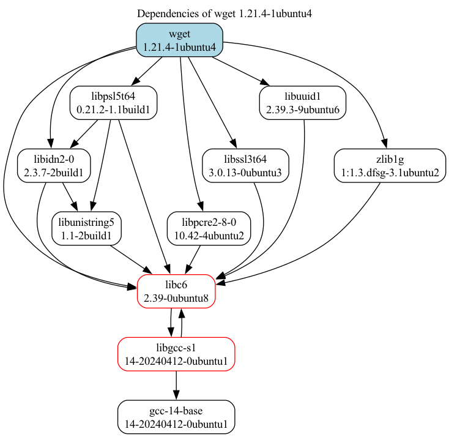
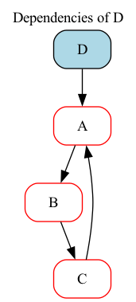
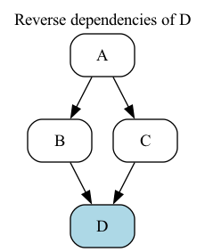
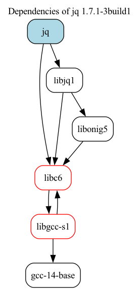
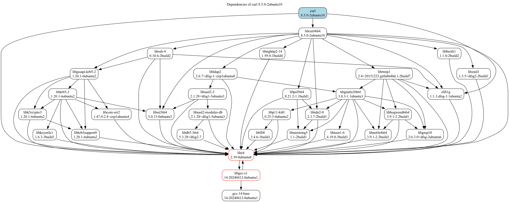
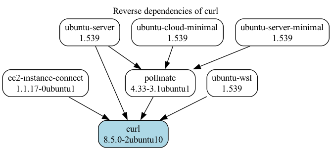

# Граф зависимостей пакетов Ubuntu

Практическая работа №2 по дисциплине «Конфигурационное управление»,
вариант 27.

Программа строит граф зависимостей пакета Ubuntu (формат apt) и рисует
его картинкой. Данные берутся прямо из индекса репозитория, без apt и
сторонних библиотек. Картинку рисует Graphviz.

Сделаны все 5 этапов: параметры командной строки, получение зависимостей
из репозитория Ubuntu, полный граф с учётом циклов и тестовый режим,
обратные зависимости, визуализация в Graphviz и сравнение со штатными
инструментами apt.



## Параметры

```
./run.sh --package ИМЯ --repo URL_ИЛИ_ФАЙЛ [--test] [--version ВЕРСИЯ] [--output ФАЙЛ.png] [--reverse]
```

| Параметр | Что это | Проверка |
|---|---|---|
| `--package` | имя пакета | обязателен; строчные буквы, цифры, `+ - .` (в тестовом режиме — заглавные латинские буквы) |
| `--repo` | URL файла `Packages` репозитория или путь к тестовому репозиторию | обязателен; `http`/`https` адрес (в тестовом режиме — существующий файл) |
| `--test` | режим тестового репозитория | флаг |
| `--version` | версия пакета | необязателен; начинается с цифры, без пробелов |
| `--output` | файл, куда сохранить картинку графа | по умолчанию `graph.png`; расширение `.png`, папка должна существовать |
| `--reverse` | нарисовать обратные зависимости | флаг |

Параметры проверяются библиотекой pydantic. При ошибке печатается
сообщение `error: ...` и программа завершается с кодом 1. Если не указан
обязательный параметр, ошибку выдаёт argparse (код 2).

## Откуда берутся зависимости

Репозиторий Ubuntu хранит индекс пакетов — файл `Packages` (обычно
сжатый, `Packages.gz`). Например, для Ubuntu 24.04, раздел `main`:

```
http://archive.ubuntu.com/ubuntu/dists/noble/main/binary-amd64/Packages.gz
```

Внутри — описания пакетов, разделённые пустой строкой:

```
Package: curl
Version: 8.5.0-2ubuntu10
Depends: libc6 (>= 2.34), libcurl4t64 (= 8.5.0-2ubuntu10), zlib1g (>= 1:1.1.4)
```

Программа скачивает индекс стандартным `urllib`, распаковывает (`.gz`
или `.xz`) и разбирает сама. Прямые зависимости — это пакеты из полей
`Pre-Depends` и `Depends`. Ограничения версий `(>= 2.34)` и архитектуры
`:any` отбрасываются. Если указано несколько вариантов через `|`,
берётся первый — его apt и ставит по умолчанию.

**Версия.** В одном индексе может быть несколько версий пакета (например,
в репозитории Docker их десятки). С `--version` берётся указанная,
без него — последняя в индексе. Если такой версии нет, программа
покажет, какие есть.

**Виртуальные пакеты.** Некоторые имена в `Depends` — не настоящие
пакеты, а «виртуальные»: их предоставляет другой пакет через поле
`Provides`. Например, в Ubuntu 24.04 `libssl3` переименован в
`libssl3t64`, а старое имя осталось в его `Provides`. Программа
подставляет настоящий пакет вместо виртуального — так делает и apt.

**Ошибки:** адрес недоступен или файл не найден (404), архив повреждён,
в файле нет пакетов, нет такого пакета, нет такой версии.

## Граф зависимостей

Зависимости бывают прямые (`curl` → `libcurl4t64`) и транзитивные
(`libcurl4t64` → `libssl3t64`, значит `curl` тоже зависит от
`libssl3t64`). Граф собирается обходом в ширину (BFS) без рекурсии:

1. В очередь кладётся исходный пакет.
2. Из очереди берётся пакет. Если он уже обработан — пропускаем.
3. Иначе запоминаем его прямые зависимости и кладём их в очередь.
4. Повторяем, пока очередь не пуста.

**Циклы.** Пакет может через цепочку зависимостей зависеть сам от себя:
в Ubuntu `libc6` зависит от `libgcc-s1`, а тот — от `libc6`. Шаг 2
(«уже обработан — пропускаем») не даёт обходу зациклиться. Пакеты,
которые входят в циклы, на картинке обведены красным.



## Обратные зависимости

С флагом `--reverse` программа рисует не то, от чего зависит пакет,
а **кто зависит от него** — прямо или через другие пакеты.

Для этого все рёбра репозитория «переворачиваются»: если `A` зависит
от `B`, получается ребро «от `B` зависит `A`». Затем запускается тот же
обход в ширину, что и для обычного графа, только по перевёрнутым рёбрам.
На картинке стрелка всё равно идёт от пакета к его зависимости:



## Тестовый режим

С флагом `--test` вместо репозитория Ubuntu читается текстовый файл.
Пакеты называются заглавными латинскими буквами, одна строка — один
пакет и его прямые зависимости:

```
# комментарий
A: B C
B: D
C: D
D:
```

Пакет, который встречается только в зависимостях (не описан своей
строкой), считается пакетом без зависимостей. Ошибки: строка не по
формату (печатается номер строки), пакет описан дважды, в файле нет
пакетов, запрошенного пакета нет.

Готовые примеры в `repos/`:

| Файл | Что проверяет |
|---|---|
| `simple.txt` | простой граф |
| `diamond.txt` | общая зависимость (ромб) — обрабатывается один раз |
| `cycle.txt` | цикл A → B → C → A; D ведёт в цикл снаружи |
| `self.txt` | пакет зависит сам от себя |
| `complex.txt` | два цикла и пакет без описания |
| `broken.txt` | ошибка формата |
| `empty.txt` | файл без пакетов |

## Визуализация

Программа описывает граф на языке Graphviz, печатает этот текст и
передаёт его программе `dot`, которая рисует PNG:

```
$ ./run.sh --package A --repo repos/diamond.txt --test --output diamond.png
digraph dependencies {
    label="Dependencies of A";
    labelloc=t;
    node [shape=box, style=rounded];
    "A" [style="rounded,filled", fillcolor=lightblue];
    "B";
    "C";
    "D";
    "A" -> "B";
    "A" -> "C";
    "B" -> "D";
    "C" -> "D";
}
Image saved to diamond.png, packages: 4
```

- `digraph` — ориентированный граф (стрелки имеют направление);
- `"B";` — узел, то есть пакет;
- `"A" -> "B";` — стрелка: `A` зависит от `B`;
- исходный пакет закрашен голубым, пакеты в циклах обведены красным;
- у реальных пакетов под именем написана версия (`label="имя\nверсия"`).

Версия на картинке — та, что попала в граф: у исходного пакета —
выбранная через `--version` (или последняя), у остальных — последняя в
индексе. У тестовых пакетов `A`, `B`, `C` версий нет, поэтому у них
только имя:

```
$ ./run.sh --package wget --repo http://archive.ubuntu.com/ubuntu/dists/noble/main/binary-amd64/Packages.gz
digraph dependencies {
    label="Dependencies of wget 1.21.4-1ubuntu4";
    labelloc=t;
    node [shape=box, style=rounded];
    "wget" [label="wget\n1.21.4-1ubuntu4", style="rounded,filled", fillcolor=lightblue];
    "libc6" [label="libc6\n2.39-0ubuntu8", color=red];
    ...
    "wget" -> "libc6";
    ...
}
Image saved to graph.png, packages: 11
```

Картинку рисует команда `dot -Tpng -o diamond.png` — программа
запускает её через `subprocess`. Для этого нужен установленный Graphviz;
если его нет, программа выводит `error: Graphviz is not installed`.

### Примеры для трёх пакетов

| `jq` — 6 пакетов | `wget` — 11 пакетов |
|---|---|
|  |  |

`curl` — 32 пакета:



Кто зависит от `curl` (`--reverse`):



## Сравнение со штатными инструментами

Для apt есть свои инструменты:

- `apt-cache depends --recurse` — входит в apt, печатает все зависимости
  списком;
- `apt-cache rdepends` — обратные зависимости;
- `debtree` — рисует граф зависимостей в Graphviz, как наша программа.

На macOS apt нет, поэтому они запускаются в Docker-контейнере
Ubuntu 24.04 (`sh scripts/compare.sh`), результаты лежат в
`examples/apt/`. Чтобы сравнение было честным, в контейнере подключён
тот же индекс (`noble main`), а у `apt-cache` выключены необязательные
связи (`--no-recommends --no-suggests ...`).

**Результат: прямые зависимости совпадают полностью.**

| Пакет | Наша программа | `apt-cache depends --recurse` |
|---|---|---|
| `jq` | 6 пакетов, 8 рёбер | то же самое |
| `wget` | 11 пакетов, 20 рёбер | то же самое |
| `curl` | 32 пакета, 81 ребро | то же самое |

Расхождения есть, и у каждого есть причина:

1. **Виртуальные пакеты.** `apt-cache` показывает виртуальное имя
   отдельно (`Depends: <libssl3>`, а под ним `libssl3t64`), а наша
   программа сразу подставляет настоящий пакет. Рёбра те же, просто
   у apt-cache в списке на 4 имени больше (`<libssl3>`, `<libgnutls30>`,
   `<libhogweed6>`, `<libnettle8>`).
2. **Обратные зависимости.** `apt-cache rdepends curl` находит 6
   пакетов, наша программа — 4 прямых. Лишние у apt — `spamassassin` и
   `ieee-data`: они требуют curl только как запасной вариант
   (`ieee-data: Depends: wget | libwww-perl | curl`). Мы берём из
   `a | b` первый вариант — то, что apt поставит на самом деле, — поэтому
   curl в их граф не попадает. apt-cache перечисляет все варианты.
3. **debtree рисует другой граф.** Сравните
   [`examples/apt/wget-debtree.png`](examples/apt/wget-debtree.png) с
   [`examples/wget.png`](examples/wget.png):
   - debtree скрывает базовые пакеты `libc6`, `zlib1g` (список в
     `/etc/debtree/endlist`), поэтому их нет на картинке;
   - показывает и рекомендуемые пакеты (`Recommends`: `ca-certificates`,
     `uuid-runtime`, `publicsuffix`) и идёт дальше по ним — граф
     получается больше;
   - показывает конфликты (красная стрелка `wget → wget-ssl`),
     варианты `a | b` и виртуальные пакеты особыми узлами;
   - подписывает на стрелках ограничения версий `(>= 2.16)`.
   Наша программа рисует только обязательные зависимости (`Depends`,
   `Pre-Depends`) без ограничений версий — так требует задание.
4. **Версии.** В обычной системе apt читает ещё `noble-updates` и
   `noble-security` и берёт более новую версию (curl
   `8.5.0-2ubuntu10.16`, а не `8.5.0-2ubuntu10`). Наша программа
   читает один индекс — тот, что указан в `--repo`.

## Как запустить

Нужны Python 3.12, [uv](https://docs.astral.sh/uv/) и
[Graphviz](https://graphviz.org/) (`brew install graphviz` или
`sudo apt install graphviz`).

```sh
uv sync                      # поставить зависимости
./run.sh --help              # справка по параметрам
uv run pytest                # тесты
uv run ruff check src tests  # линтер
sh scripts/stage1.sh         # демонстрация этапа 1
sh scripts/stage2.sh         # демонстрация этапа 2 (нужен интернет)
sh scripts/stage3.sh         # демонстрация этапа 3
sh scripts/stage4.sh         # демонстрация этапа 4
sh scripts/stage5.sh         # демонстрация этапа 5, картинки в examples/
sh scripts/compare.sh        # сравнение с apt-cache и debtree (нужен Docker)
```

Скрипты `stage2.sh`–`stage4.sh` показывают вывод своих этапов, поэтому
запускать их лучше на коммите своего этапа (см. ниже).

## Структура

```
src/depgraph/
    main.py        запуск, чтение параметров
    config.py      проверка параметров (pydantic)
    repository.py  общий интерфейс репозитория
    apt.py         чтение индекса пакетов Ubuntu
    file_repo.py   тестовый репозиторий из файла
    graph.py       обход в ширину и граф зависимостей
    dot.py         текст на языке Graphviz и картинка PNG
tests/           тесты
repos/           тестовые репозитории
examples/        картинки графов и вывод штатных инструментов apt
scripts/         демонстрационные скрипты
run.sh           скрипт запуска
```

## Этапы

Каждый этап заканчивается отдельным коммитом. Чтобы посмотреть проект
в состоянии на конец этапа:

```sh
git checkout 742a862   # этап 1
git checkout 40b0ba1   # этап 2
git checkout 505b6c9   # этап 3
git checkout b963b04   # этап 4
git checkout 8f46606   # этап 5
git checkout main      # вернуться к последней версии
```

- Этап 1 (минимальный прототип с конфигурацией) — `742a862`
- Этап 2 (сбор данных) — `40b0ba1`
- Этап 3 (основные операции) — `505b6c9`
- Этап 4 (дополнительные операции) — `b963b04`
- Этап 5 (визуализация) — `8f46606`

Подробно по каждому этапу — шаги-коммиты, как запустить, что выводится
и что поменялось в коде — в [STAGES.md](STAGES.md).
